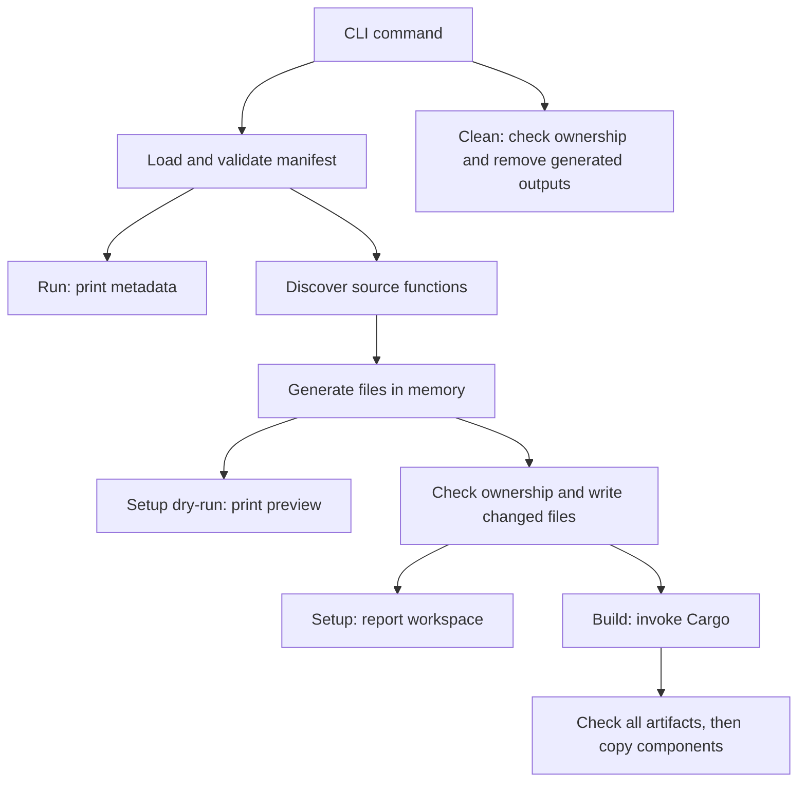

# Architecture

This page explains the current runner's responsibilities and design choices.
[Requirements](SPEC.md) state the outcomes; the [reference](docs/reference.md)
defines exact public behavior. Contributor commands and verification practices
live in [Contributing](CONTRIBUTING.md).

## Structure

The runner is a single Rust package. Application handlers compile in separate
generated guest workspaces.

| Component | Responsibility |
| --- | --- |
| [main](src/main.rs) | Report errors and return the process exit status |
| [CLI parser](src/cli/mod.rs) | Parse top-level arguments and dispatch commands |
| [setup](src/cli/setup.rs), [build](src/cli/build.rs), [clean](src/cli/clean.rs), [run](src/cli/run.rs) | Keep each command's arguments, orchestration, and presentation together |
| [Manifest service](src/services/manifest.rs) | Own application/dependency types, load and validate YAML, check cross-function constraints and configured sources, and resolve component paths |
| [Workspace service](src/services/workspace.rs) | Discover sources, select dependencies, render workspace files, merge user configuration, write generated files, and clean owned outputs |
| [Build service](src/services/build.rs) | Invoke Cargo and publish components from deterministic artifact paths |

Services are independent of CLI argument types and presentation. They return
results for commands to present; Cargo's diagnostics pass through directly.
This keeps application operations reusable without introducing generic provider
or trigger frameworks.

## Important flows

Setup, build, and run load the manifest once within their command workflows.
Clean only needs the directory, allowing recovery from invalid or missing
application inputs. Run ends at metadata; component paths and routes do not
imply execution or a bound listener.

YAML parsing and merge resolution use `yaml_serde`. The resolved document is
validated by `jsonschema` against the embedded schema and deserialized into
application types. Route uniqueness and source existence need additional checks
because they span functions or depend on the filesystem. Library diagnostics
receive basic operation context through `anyhow`; custom source-location
tracking is not part of the design. See [validation stages](docs/reference.md#validation-stages).

## Guest workspace boundary

Guest and runner workspaces are separate so application dependencies, lockfiles,
and build artifacts have their own lifecycle. The application-root Cargo
manifest also gives editor tooling a discoverable workspace. Each discovered
function gets a `cdylib` package with explicit workspace membership and a
library name, making artifact paths predictable. The
[generated-file reference](docs/reference.md#generated-files) defines the layout.

Generated entry points include the original handler sources and use the embedded
[WIT world](wit/world.wit) to generate bindings. They implement the exported guest
trait and expose its `Request` and `Response` types directly to handlers.
There is no parallel request/response model or conversion layer to keep in sync.

The original sources live outside the generated package directories. Setup
therefore merges a rust-analyzer source include into the application's editor
settings; Cargo resolves the source paths without that configuration. The
[editor guide](docs/guides.md#prepare-vs-code) covers workspace selection.

## Generation and ownership

Generation produces a sorted map of relative paths to contents before any
writes. Preview and writing share that output, so validation and rendering
failures cannot leave a partially generated workspace. TOML serialization uses
`toml`; `jsonc-parser` merges editor settings while preserving existing comments
and formatting. Ignore entries are merged as literal lines rather than by
interpreting pattern semantics.

The writer checks the root manifest's ownership marker before modifying files
and skips identical content to preserve incremental compilation. Cleanup checks
the same marker before removing its documented outputs. These checks protect
handwritten manifests; they do not make filesystem operations transactional.
Obsolete generated files stay in place until cleanup. Exact preservation and
failure boundaries are in [Setup](docs/reference.md#setup) and
[Clean](docs/reference.md#clean).

## Compilation and publication

Cargo owns dependency resolution, lockfiles, incremental compilation, concurrency,
and compiler diagnostics. The build service supplies the WASM target, profile,
and application-local target directory. It computes artifact paths from explicit
library names instead of parsing Cargo JSON output, reducing orchestration to
the information it needs.

Only successful compilation followed by existence checks for all expected
artifacts allows publication to begin. This prevents failed Cargo builds from
publishing stale outputs as new successes. Copies are not transactional: a later
copy failure can leave mixed published outputs. See [Build](docs/reference.md#build).

## Runtime boundary

There is no component runtime, HTTP transport, or host capability policy yet.
The current guest world declares no host imports, but `wasm32-wasip2` can
introduce WASI imports that a future host must satisfy. The custom guest
interface is not WASI HTTP.

Future execution and trigger design belongs to the
[open product decisions](SPEC.md#open-decisions). Add concrete boundaries when
those features are agreed; do not scaffold unused runtime or trigger modules.
