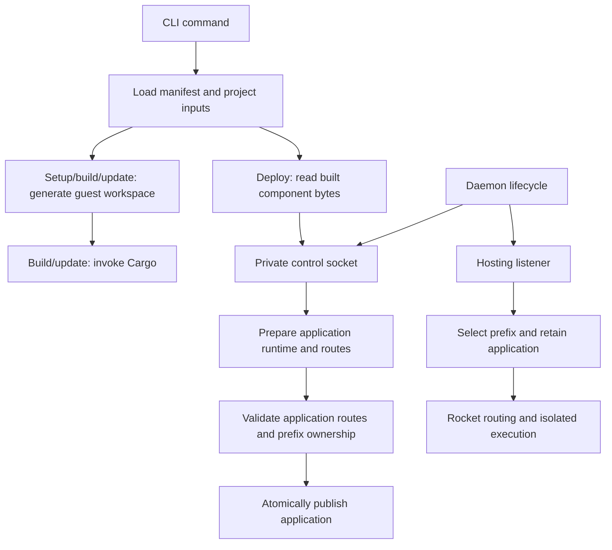

# Architecture

This page explains the current runner's responsibilities and design choices.
[Requirements](SPEC.md) state the outcomes; the [reference](docs/reference.md)
defines exact public behavior. Contributor commands and verification practices
live in [Contributing](CONTRIBUTING.md).

## Structure

The runner is one Rust package with a library and a thin CLI binary. Modules
are grouped by responsibility; the runtime and foreground server remain publicly
re-exported for embedding. Application handlers compile in separate generated
guest workspaces.

| Component | Responsibility |
| --- | --- |
| [main](src/main.rs) | Report errors and return the process exit status |
| [CLI](src/cli/mod.rs) | Parse arguments and dispatch commands |
| [Application commands](src/cli/application), [daemon commands](src/cli/daemon.rs), [application management](src/cli/apps.rs) | Command orchestration and presentation |
| [Project](src/project) | Manifest validation, source discovery, workspace generation, Cargo invocation, and packaging existing component bytes |
| [Daemon](src/daemon/mod.rs) | Compose the application registry and listeners; coordinate readiness and shutdown |
| [Process lifecycle](src/daemon/process.rs) | Background launch, singleton lock, private state paths, readiness handshake, and cleanup |
| [Control](src/control) | Shared wire protocol, client transport, and management request handlers |
| [Admin command](src/cli/admin.rs), [admin UI](src/admin) | Select a daemon and own a separate local HTTP listener, live metadata queries, and HTML presentation |
| [Applications](src/hosting/applications.rs) | Prepare, publish, list, and remove application generations |
| [Routing](src/hosting/routing.rs) | Construct and validate each application’s prepared Rocket routes |
| [Hosting server](src/hosting/server.rs) | Translate HTTP, bound execution admission, and drain shutdown |
| [Runtime](src/runtime.rs) | Compile components, own the engine/ticker, and invoke fresh isolated instances |

Project tooling knows files and Cargo; deployment transfers identity, the declared path prefix, routes,
and bytes without source paths. Control handlers call application operations;
application hosting has no dependency on control transport or CLI types. The
runtime remains independent of manifests and HTTP transport. These are concrete
modules rather than provider traits or separate crates.

## Important flows

Setup, build, update, run, and deploy load the manifest once within their command
workflows. Clean only needs the directory, allowing recovery from invalid or
missing inputs. Run and deploy read existing components without generating
files or invoking Cargo. Native compilation belongs to runtime preparation.

YAML parsing and merge resolution use `yaml_serde`. The resolved document is
validated by `jsonschema` against the embedded schema and deserialized into
application types. Rocket parses route URIs and rejects route collisions during
dispatcher ignition. Source existence needs filesystem checks. Diagnostics use
basic operation context through `anyhow`; there is no custom source-location
tracking. See [validation stages](docs/reference.md#validation-stages).

## Live applications and daemon lifecycle

The application registry holds a sorted map of names to immutable application
generations. Each generation owns its declared path prefix, one runtime, and an
untracked asynchronous Rocket local client. Component preparation runs on the
blocking pool, and that application's routes are validated before publication.
A short read/write lock protects checking prefix ownership against the latest
registry and replacing the application. Duplicate and ancestor/descendant
prefixes are rejected. Shutdown checks use the same lock, so a late deployment
cannot publish after admission closes. Old generations are dropped outside the
lock. Independent application routers remove the need to rebuild a combined
router or serialize asynchronous preparation across applications.

The network listener selects an application using its literal, segment-bounded
prefix, removes that prefix, and forwards the remaining encoded path and original
query into the application's in-process Rocket dispatcher. `/` is the remaining
path for a request exactly at the mount point. Prefixes are canonical unreserved
ASCII paths; there are no dynamic prefix captures or encoded aliases. Function
routing, decoding, ranking, and collision detection remain Rocket's responsibility.
The manifest owns the prefix for both run and deployment. Neither command
infers it from the name, accepts an override flag, or retains an old prefix.

Rocket's route matcher is private and its live route set is immutable; local
dispatch preserves its behavior without implementing a second function router.
It opens no additional listening sockets. The tradeoff is an additional bounded
request-buffer copy and response adaptation. Clients are untracked so cookies
are not shared between requests. HEAD forwarding preserves the representation
size even though local dispatch has already stripped its body.

The listener and every application share one execution-admission state. Requests
retain the selected application through dispatch; blocking executions also own
its runtime. Replaced/removed generations are reclaimed after the final
reference drops. Per-generation runtimes avoid changing the public runtime API,
at the cost of an engine and ticker per deployed application generation. The
public `server::serve` embedding API remains rooted at `/`; the foreground CLI
uses the same registry and hosting path with the manifest's prefix.

The daemon owns both listeners and shuts down the other if either fails. Its
process-held file lock covers stale-socket cleanup through final shutdown; it
never trusts a recorded PID or unlinks the lock file. The start command first
queries live status and reports an existing instance without spawning a child.
For a new instance, background start waits
for a readiness line from the child after both binds. The child runs in its own
process group with terminal input disconnected and diagnostics appended to its
log. Unix control transport is length-framed JSON with bounded message sizes,
concurrency, and read/write deadlines. Deployment state is deliberately volatile.

## Local admin UI

The foreground `wr admin` client owns a loopback Rocket listener independently
of the daemon. Each overview request uses the existing status protocol over
the selected Unix socket; the daemon remains the source of metadata and does
not render HTML. Application hosting and its root mounts are unaffected.
Application metadata includes function names, methods, and relative paths read
from each active Rocket dispatcher. This keeps inspection tied to the published
generation without retaining a second copy of deployment metadata or component
bytes. Functions are sorted by name before being returned over control transport.

The control client provides synchronous transport for existing CLI commands
and asynchronous transport for HTTP handlers, sharing wire encoding and reply
validation. The UI bounds the complete async exchange with a deadline;
cancellation drops the socket instead of leaving a blocked worker behind.
There is no metadata cache or polling task. The CLI owns process signals and
readiness reporting; the UI server owns rendering and HTTP responses.

Rocket's HTML responder wraps a small embedded page shell and directly rendered,
escaped status and table content. The stylesheet is also embedded. This single
view needs no template-engine dependency, frontend build, runtime asset files,
or separate browser API. Exact behavior lives in the
[admin reference](docs/reference.md#admin-ui).

## Guest workspace boundary

Guest and runner workspaces are separate so application dependencies, lockfiles,
and build artifacts have their own lifecycle. The application-root Cargo
manifest also gives editor tooling a discoverable workspace. Each discovered
function gets a `cdylib` package with explicit workspace membership and a
library name, making artifact paths predictable. The
[generated-file reference](docs/reference.md#generated-files) defines the layout.

Generated entry points include the original handler sources and use the embedded
[WIT world](wit/world.wit) to generate bindings. They implement the exported guest
trait and expose its `Request` and `Response` types directly to handlers.
There is no parallel request/response model or conversion layer to keep in sync.

The original sources live outside the generated package directories. Setup
therefore merges a rust-analyzer source include into the application's editor
settings; Cargo resolves the source paths without that configuration. The
[editor guide](docs/guides.md#prepare-vs-code) covers workspace selection.

## Generation and ownership

Generation produces a sorted map of relative paths to contents before any
writes. Preview and writing share that output, so validation and rendering
failures cannot leave a partially generated workspace. TOML serialization uses
`toml`; `jsonc-parser` merges editor settings while preserving existing comments
and formatting. Ignore entries are merged as literal lines rather than by
interpreting pattern semantics.

The writer checks the root manifest's ownership marker before modifying files
and skips identical content to preserve incremental compilation. Cleanup checks
the same marker before removing its documented outputs. These checks protect
handwritten manifests; they do not make filesystem operations transactional.
Obsolete generated files stay in place until cleanup. Exact preservation and
failure boundaries are in [Setup](docs/reference.md#setup) and
[Clean](docs/reference.md#clean).

## Compilation and publication

Cargo owns dependency resolution, lockfiles, incremental compilation, concurrency,
and compiler diagnostics. The build service supplies the WASM target, profile,
and application-local target directory. It computes artifact paths from explicit
library names instead of parsing Cargo JSON output, reducing orchestration to
the information it needs.

Builds pass `--locked` to Cargo unless the user explicitly selects `--unlocked`.
Update shares workspace generation and ownership checks, then delegates to
`cargo update` without compilation or publication. This keeps dependency upgrades
explicit and uses Cargo's resolver instead of maintaining separate lockfile logic.

Only successful compilation followed by existence checks for all expected
artifacts allows publication to begin. This prevents failed Cargo builds from
publishing stale outputs as new successes. Copies are not transactional: a later
copy failure can leave mixed published outputs. See [Build](docs/reference.md#build).

## Runtime and transport boundaries

The runtime owns a Wasmtime engine with epoch interruption and a dedicated
ticker thread. It retains typed pre-instantiated component metadata after
registration resolves imports and checks exports. Every call creates a new
store, resource table, WASI context, and guest instance. Registration takes
mutable access; execution shares immutable prepared code without a shared
guest instance or execution mutex. Opaque IDs carry runtime ownership identity.
Dropping the runtime signals and joins its ticker thread.

Deadlines are configured to trap, not yield. The allowance starts inside the
synchronous invocation and includes instantiation. An extra epoch tick prevents
calls arriving just before a tick from expiring early; the elapsed-time check
also catches calls that return after their allowance. Epochs cannot interrupt
arbitrary host functions. A registration allowlist and capability-free WASI
contexts limit the current host surface to the
[documented policy](docs/reference.md#runtime-and-wasi-policy).

Each application dispatcher registers each configured URI directly as a Rocket route
with its default rank. Rocket owns routing, method matching, collision detection, and
slash handling. There is no parallel route ordering or overlap algorithm.
The small capture adapter pairs names from the matched route with Rocket's
decoded request segments for the WIT request. The encoded application-relative path comes from
Rocket's local request URI after prefix removal. The hosting listener's liftoff callback reports the actual bound address
only after ignition and binding succeed.

Each request buffers a bounded body under a read timeout before attempting an
immediate execution-slot acquisition. Synchronous runtime calls run through
Tokio's blocking pool. The owned semaphore permit moves into the blocking job,
so dropping an HTTP future cannot release capacity prematurely. Shutdown marks
admission closed, notifies Rocket, and acquires all permits before
returning, including permits held by detached jobs. Process signals are the
CLI's responsibility; embedding callers provide a shutdown future.

The runtime exposes request/response types generated from the same WIT
used by guest workspaces. Its API does not depend on manifest or CLI types. The server
encapsulates module IDs and confines HTTP validation, framing, and error mapping
to the transport boundary. No separate runtime test harness is maintained:
examples exercise it through the server, with straightforward automated socket
checks and manual concurrency/failure scenarios.
