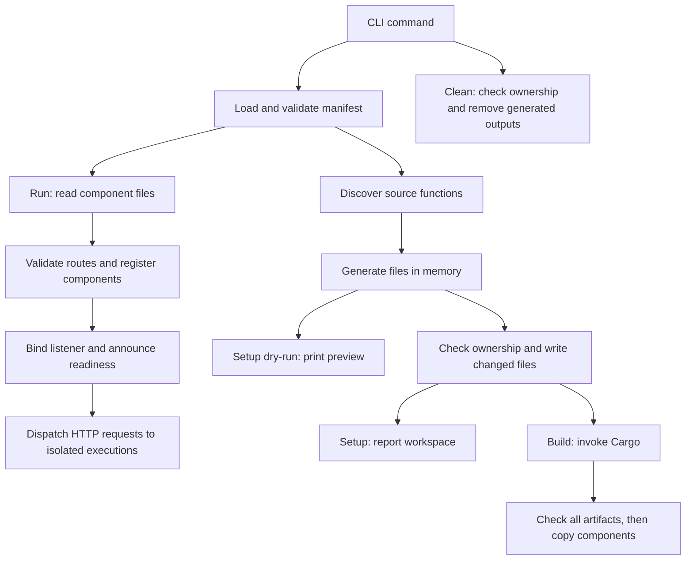

# Architecture

This page explains the current runner's responsibilities and design choices.
[Requirements](SPEC.md) state the outcomes; the [reference](docs/reference.md)
defines exact public behavior. Contributor commands and verification practices
live in [Contributing](CONTRIBUTING.md).

## Structure

The runner is a single Rust package with a library and a thin CLI binary.
The library owns the CLI modules and a single service module tree; the binary
calls its CLI entry point. Runtime and server modules are publicly re-exported
for embedding, while the other service modules remain internal. Application
handlers compile in separate generated guest workspaces.

| Component | Responsibility |
| --- | --- |
| [main](src/main.rs) | Report errors and return the process exit status |
| [CLI parser](src/cli/mod.rs) | Parse top-level arguments and dispatch commands |
| [setup](src/cli/setup.rs), [build](src/cli/build.rs), [clean](src/cli/clean.rs), [run](src/cli/run.rs) | Keep each command's arguments, orchestration, and presentation together |
| [Manifest service](src/services/manifest.rs) | Own application/dependency types, load and validate YAML, parse route URIs with Rocket, check configured sources, and resolve component paths |
| [Workspace service](src/services/workspace.rs) | Discover sources, select dependencies, render workspace files, merge user configuration, write generated files, and clean owned outputs |
| [Build service](src/services/build.rs) | Invoke Cargo and publish components from deterministic artifact paths |
| [Component loader](src/services/loader.rs) | Read configured component files with function/path diagnostics |
| [Runtime](src/services/runtime.rs) | Compile and validate components, own the engine/ticker, and invoke fresh isolated instances |
| [HTTP server](src/services/server.rs) | Register Rocket routes, translate HTTP, bound execution admission, and drain shutdown |

Services are independent of CLI argument types and presentation. They return
results for commands to present; Cargo's diagnostics pass through directly.
This keeps application operations reusable without introducing generic provider
or trigger frameworks.

## Important flows

Setup, build, and run load the manifest once within their command workflows.
Clean only needs the directory, allowing recovery from invalid or missing
application inputs. Run loads existing components without generating files or
invoking Cargo. Native compilation belongs to runtime registration, not loading.

YAML parsing and merge resolution use `yaml_serde`. The resolved document is
validated by `jsonschema` against the embedded schema and deserialized into
application types. Rocket parses route URIs; its ignition phase detects route
collisions when starting the server. Source existence needs filesystem checks. Library diagnostics
receive basic operation context through `anyhow`; custom source-location
tracking is not part of the design. See [validation stages](docs/reference.md#validation-stages).

## Guest workspace boundary

Guest and runner workspaces are separate so application dependencies, lockfiles,
and build artifacts have their own lifecycle. The application-root Cargo
manifest also gives editor tooling a discoverable workspace. Each discovered
function gets a `cdylib` package with explicit workspace membership and a
library name, making artifact paths predictable. The
[generated-file reference](docs/reference.md#generated-files) defines the layout.

Generated entry points include the original handler sources and use the embedded
[WIT world](wit/world.wit) to generate bindings. They implement the exported guest
trait and expose its `Request` and `Response` types directly to handlers.
There is no parallel request/response model or conversion layer to keep in sync.

The original sources live outside the generated package directories. Setup
therefore merges a rust-analyzer source include into the application's editor
settings; Cargo resolves the source paths without that configuration. The
[editor guide](docs/guides.md#prepare-vs-code) covers workspace selection.

## Generation and ownership

Generation produces a sorted map of relative paths to contents before any
writes. Preview and writing share that output, so validation and rendering
failures cannot leave a partially generated workspace. TOML serialization uses
`toml`; `jsonc-parser` merges editor settings while preserving existing comments
and formatting. Ignore entries are merged as literal lines rather than by
interpreting pattern semantics.

The writer checks the root manifest's ownership marker before modifying files
and skips identical content to preserve incremental compilation. Cleanup checks
the same marker before removing its documented outputs. These checks protect
handwritten manifests; they do not make filesystem operations transactional.
Obsolete generated files stay in place until cleanup. Exact preservation and
failure boundaries are in [Setup](docs/reference.md#setup) and
[Clean](docs/reference.md#clean).

## Compilation and publication

Cargo owns dependency resolution, lockfiles, incremental compilation, concurrency,
and compiler diagnostics. The build service supplies the WASM target, profile,
and application-local target directory. It computes artifact paths from explicit
library names instead of parsing Cargo JSON output, reducing orchestration to
the information it needs.

Only successful compilation followed by existence checks for all expected
artifacts allows publication to begin. This prevents failed Cargo builds from
publishing stale outputs as new successes. Copies are not transactional: a later
copy failure can leave mixed published outputs. See [Build](docs/reference.md#build).

## Runtime and transport boundaries

The runtime owns a Wasmtime engine with epoch interruption and a dedicated
ticker thread. It retains typed pre-instantiated component metadata after
registration resolves imports and checks exports. Every call creates a new
store, resource table, WASI context, and guest instance. Registration takes
mutable access; execution shares immutable prepared code without a shared
guest instance or execution mutex. Opaque IDs carry runtime ownership identity.
Dropping the runtime signals and joins its ticker thread.

Deadlines are configured to trap, not yield. The allowance starts inside the
synchronous invocation and includes instantiation. An extra epoch tick prevents
calls arriving just before a tick from expiring early; the elapsed-time check
also catches calls that return after their allowance. Epochs cannot interrupt
arbitrary host functions. A registration allowlist and capability-free WASI
contexts limit the current host surface to the
[documented policy](docs/reference.md#runtime-and-wasi-policy).

The server registers each configured URI directly as a Rocket route with its
default rank. Rocket owns routing, method matching, collision detection, and
slash handling. There is no parallel route ordering or overlap algorithm.
The small capture adapter pairs names from the matched route with Rocket's
decoded request segments for the WIT request. The encoded path comes from
Rocket's request URI. Rocket's liftoff callback reports the actual bound address
only after ignition and binding succeed.

Each request buffers a bounded body under a read timeout before attempting an
immediate execution-slot acquisition. Synchronous runtime calls run through
Tokio's blocking pool. The owned semaphore permit moves into the blocking job,
so dropping an HTTP future cannot release capacity prematurely. Shutdown marks
admission closed, notifies Rocket, and acquires all permits before
returning, including permits held by detached jobs. Process signals are the
CLI's responsibility; embedding callers provide a shutdown future.

The runtime exposes request/response types generated from the same WIT
used by guest workspaces. Its API does not depend on manifest or CLI types. The server
encapsulates module IDs and confines HTTP validation, framing, and error mapping
to the transport boundary. No separate runtime test harness is maintained:
examples exercise it through the server, with straightforward automated socket
checks and manual concurrency/failure scenarios.
