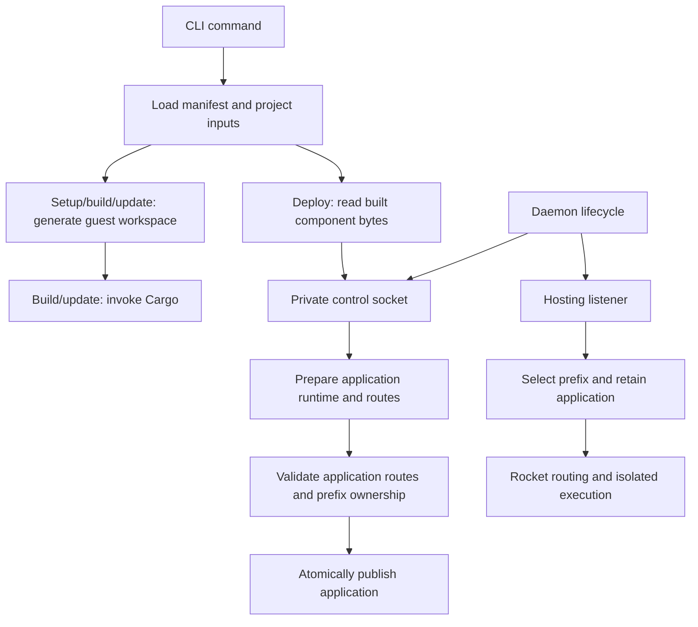
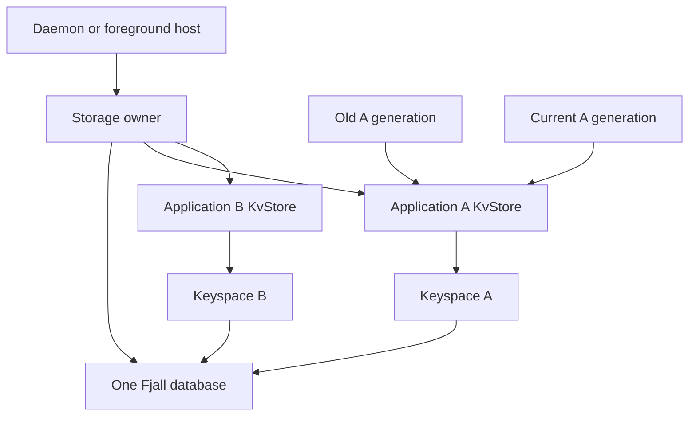

# Architecture

This page explains the current runner's responsibilities and design choices.
[Requirements](SPEC.md) state the outcomes; the [reference](docs/reference.md)
defines exact public behavior. Contributor commands and verification practices
live in [Contributing](CONTRIBUTING.md).

## Structure

The runner is one Rust package with a library and a thin CLI binary. Modules
are grouped by responsibility; the runtime and foreground server remain publicly
re-exported for embedding. Application handlers compile in separate generated
guest workspaces.

| Component | Responsibility |
| --- | --- |
| [main](src/main.rs) | Report errors and return the process exit status |
| [CLI](src/cli/mod.rs) | Parse arguments and dispatch commands |
| [Application commands](src/cli/application), [daemon commands](src/cli/daemon.rs), [application management](src/cli/apps.rs) | Command orchestration and presentation |
| [Project](src/project) | Manifest validation, source discovery, workspace generation, Cargo invocation, and packaging existing component bytes |
| [Daemon](src/daemon/mod.rs) | Compose the application registry and listeners; coordinate readiness and shutdown |
| [Process lifecycle](src/daemon/process.rs) | Background launch, singleton lock, private state paths, readiness handshake, and cleanup |
| [Control](src/control) | Shared wire protocol, client transport, and management request handlers |
| [Admin command](src/cli/admin.rs), [admin UI](src/admin) | Select a daemon and own a separate local HTTP listener, live metadata queries, and HTML presentation |
| [Applications](src/hosting/applications.rs) | Prepare, publish, list, and remove application generations |
| [Routing](src/hosting/routing.rs) | Construct and validate each application’s prepared Rocket routes |
| [Hosting server](src/hosting/server.rs) | Translate HTTP, bound execution admission, and drain shutdown |
| [Runtime](src/runtime/mod.rs) | Compile components, own the engine/ticker, and invoke fresh isolated instances |

Project tooling knows files and Cargo; deployment transfers identity, the declared path prefix, routes,
and bytes without source paths. Control handlers call application operations;
application hosting has no dependency on control transport or CLI types. The
runtime remains independent of manifests and HTTP transport. These are concrete
modules rather than provider traits or separate crates.

### Module grouping

The runtime uses a directory module, following the existing CLI, hosting, and
project layout. The KV implementation will add persistence alongside it:

```text
src/
  lib.rs
  main.rs
  persistence/
    mod.rs
    storage.rs
  runtime/
    mod.rs
```

The persistence directory is planned and not yet implemented. Add `src/persistence/mod.rs`
as the module entry point, with a private `storage` module and public re-exports
of `Storage` and `KvStore`. Their implementation belongs in
`src/persistence/storage.rs`. Expose the module from [lib.rs](src/lib.rs) as
`persistence`, giving embedders `wasm_runner::persistence::{Storage, KvStore}`.
The directory can accommodate future persistence capabilities such as SQL,
but this increment adds no SQL module or generic provider framework.

The runtime implementation lives in [runtime/mod.rs](src/runtime/mod.rs).
The existing `pub mod runtime` declaration and public paths such as
`wasm_runner::runtime::Runtime` remain unchanged. Keep the implementation
together initially and introduce
private child modules only when concrete responsibilities warrant a split.
The runtime remains independent of HTTP hosting and uses the persistence
capability supplied to it; it does not own storage-path selection.

## Important flows



Setup, build, update, run, and deploy load the manifest once within their command
workflows. Clean only needs the directory, allowing recovery from invalid or
missing inputs. Run and deploy read existing components without generating
files or invoking Cargo. Native compilation belongs to runtime preparation.

YAML parsing and merge resolution use `yaml_serde`. The resolved document is
validated by `jsonschema` against the embedded schema and deserialized into
application types. Rocket parses route URIs and rejects route collisions during
dispatcher ignition. Source existence needs filesystem checks. Diagnostics use
basic operation context through `anyhow`; there is no custom source-location
tracking. See [validation stages](docs/reference.md#validation-stages).

## Live applications and daemon lifecycle

The application registry holds a sorted map of names to immutable application
generations. Each generation owns its declared path prefix, one runtime, and an
untracked asynchronous Rocket local client. Component preparation runs on the
blocking pool, and that application's routes are validated before publication.
A short read/write lock protects checking prefix ownership against the latest
registry and replacing the application. Duplicate and ancestor/descendant
prefixes are rejected. Shutdown checks use the same lock, so a late deployment
cannot publish after admission closes. Old generations are dropped outside the
lock. Independent application routers remove the need to rebuild a combined
router or serialize asynchronous preparation across applications.

The network listener selects an application using its literal, segment-bounded
prefix, removes that prefix, and forwards the remaining encoded path and original
query into the application's in-process Rocket dispatcher. `/` is the remaining
path for a request exactly at the mount point. Prefixes are canonical unreserved
ASCII paths; there are no dynamic prefix captures or encoded aliases. Function
routing, decoding, ranking, and collision detection remain Rocket's responsibility.
The manifest owns the prefix for both run and deployment. Neither command
infers it from the name, accepts an override flag, or retains an old prefix.

Rocket's route matcher is private and its live route set is immutable; local
dispatch preserves its behavior without implementing a second function router.
It opens no additional listening sockets. The tradeoff is an additional bounded
request-buffer copy and response adaptation. Clients are untracked so cookies
are not shared between requests. HEAD forwarding preserves the representation
size even though local dispatch has already stripped its body.

The listener and every application share one execution-admission state. Requests
retain the selected application through dispatch; blocking executions also own
its runtime. Replaced/removed generations are reclaimed after the final
reference drops. Per-generation runtimes avoid changing the public runtime API,
at the cost of an engine and ticker per deployed application generation. The
public `server::serve` embedding API remains rooted at `/`; the foreground CLI
uses the same registry and hosting path with the manifest's prefix.

The daemon owns both listeners and shuts down the other if either fails. Its
process-held file lock covers stale-socket cleanup through final shutdown; it
never trusts a recorded PID or unlinks the lock file. The start command first
queries live status and reports an existing instance without spawning a child.
For a new instance, background start waits
for a readiness line from the child after both binds. The child runs in its own
process group with terminal input disconnected and diagnostics appended to its
log. Unix control transport is length-framed JSON with bounded message sizes,
concurrency, and read/write deadlines. Deployment state is deliberately volatile.

## Local admin UI

The foreground `wr admin` client owns a loopback Rocket listener independently
of the daemon. Each overview request uses the existing status protocol over
the selected Unix socket; the daemon remains the source of metadata and does
not render HTML. Application hosting and its root mounts are unaffected.
Application metadata includes function names, methods, and relative paths read
from each active Rocket dispatcher. This keeps inspection tied to the published
generation without retaining a second copy of deployment metadata or component
bytes. Functions are sorted by name before being returned over control transport.

The control client provides synchronous transport for existing CLI commands
and asynchronous transport for HTTP handlers, sharing wire encoding and reply
validation. The UI bounds the complete async exchange with a deadline;
cancellation drops the socket instead of leaving a blocked worker behind.
There is no metadata cache or polling task. The CLI owns process signals and
readiness reporting; the UI server owns rendering and HTTP responses.

Rocket's HTML responder wraps a small embedded page shell and directly rendered,
escaped status and table content. The stylesheet is also embedded. This single
view needs no template-engine dependency, frontend build, runtime asset files,
or separate browser API. Exact behavior lives in the
[admin reference](docs/reference.md#admin-ui).

## Guest workspace boundary

Guest and runner workspaces are separate so application dependencies, lockfiles,
and build artifacts have their own lifecycle. The application-root Cargo
manifest also gives editor tooling a discoverable workspace. Each discovered
function gets a `cdylib` package with explicit workspace membership and a
library name, making artifact paths predictable. The
[generated-file reference](docs/reference.md#generated-files) defines the layout.

Generated entry points include the original handler sources and use the embedded
[WIT world](wit/world.wit) to generate bindings. They implement the exported guest
trait and expose its `Request` and `Response` types directly to handlers.
There is no parallel request/response model or conversion layer to keep in sync.

The original sources live outside the generated package directories. Setup
therefore merges a rust-analyzer source include into the application's editor
settings; Cargo resolves the source paths without that configuration. The
[editor guide](docs/guides.md#prepare-vs-code) covers workspace selection.

## Generation and ownership

Generation produces a sorted map of relative paths to contents before any
writes. Preview and writing share that output, so validation and rendering
failures cannot leave a partially generated workspace. TOML serialization uses
`toml`; `jsonc-parser` merges editor settings while preserving existing comments
and formatting. Ignore entries are merged as literal lines rather than by
interpreting pattern semantics.

The writer checks the root manifest's ownership marker before modifying files
and skips identical content to preserve incremental compilation. Cleanup checks
the same marker before removing its documented outputs. These checks protect
handwritten manifests; they do not make filesystem operations transactional.
Obsolete generated files stay in place until cleanup. Exact preservation and
failure boundaries are in [Setup](docs/reference.md#setup) and
[Clean](docs/reference.md#clean).

## Compilation and publication

Cargo owns dependency resolution, lockfiles, incremental compilation, concurrency,
and compiler diagnostics. The build service supplies the WASM target, profile,
and application-local target directory. It computes artifact paths from explicit
library names instead of parsing Cargo JSON output, reducing orchestration to
the information it needs.

Builds pass `--locked` to Cargo unless the user explicitly selects `--unlocked`.
Update shares workspace generation and ownership checks, then delegates to
`cargo update` without compilation or publication. This keeps dependency upgrades
explicit and uses Cargo's resolver instead of maintaining separate lockfile logic.

Only successful compilation followed by existence checks for all expected
artifacts allows publication to begin. This prevents failed Cargo builds from
publishing stale outputs as new successes. Copies are not transactional: a later
copy failure can leave mixed published outputs. See [Build](docs/reference.md#build).

## Runtime and transport boundaries

The runtime owns a Wasmtime engine with epoch interruption and a dedicated
ticker thread. It retains typed pre-instantiated component metadata after
registration resolves imports and checks exports. Every call creates a new
store, resource table, WASI context, and guest instance. Registration takes
mutable access; execution shares immutable prepared code without a shared
guest instance or execution mutex. Opaque IDs carry runtime ownership identity.
Dropping the runtime signals and joins its ticker thread.

Deadlines are configured to trap, not yield. The allowance starts inside the
synchronous invocation and includes instantiation. An extra epoch tick prevents
calls arriving just before a tick from expiring early; the elapsed-time check
also catches calls that return after their allowance. Epochs cannot interrupt
arbitrary host functions. A registration allowlist and capability-free WASI
contexts limit the current host surface to the
[documented policy](docs/reference.md#runtime-and-wasi-policy).

Each application dispatcher registers each configured URI directly as a Rocket route
with its default rank. Rocket owns routing, method matching, collision detection, and
slash handling. There is no parallel route ordering or overlap algorithm.
The small capture adapter pairs names from the matched route with Rocket's
decoded request segments for the WIT request. The encoded application-relative path comes from
Rocket's local request URI after prefix removal. The hosting listener's liftoff callback reports the actual bound address
only after ignition and binding succeed.

Each request buffers a bounded body under a read timeout before attempting an
immediate execution-slot acquisition. Synchronous runtime calls run through
Tokio's blocking pool. The owned semaphore permit moves into the blocking job,
so dropping an HTTP future cannot release capacity prematurely. Shutdown marks
admission closed, notifies Rocket, and acquires all permits before
returning, including permits held by detached jobs. Process signals are the
CLI's responsibility; embedding callers provide a shutdown future.

The runtime exposes request/response types generated from the same WIT
used by guest workspaces. Its API does not depend on manifest or CLI types. The server
encapsulates module IDs and confines HTTP validation, framing, and error mapping
to the transport boundary. No separate runtime test harness is maintained:
examples exercise it through the server, with straightforward automated socket
checks and manual concurrency/failure scenarios.

## Proposed KV storage

This section describes the unimplemented [KV increment](SPEC.md#proposed-increment-persistent-application-kv).
Use one embedded Fjall database per host storage root and one keyspace per
application. Keep the database and application handles alive until shutdown.
The runner supplies identity, capability enforcement, lifecycle, and inspection;
Fjall supplies storage, journaling, buffering, compaction, and recovery.

This follows Fjall's [single-database ownership recommendation](https://docs.rs/fjall/latest/fjall/struct.Database.html)
and [basic usage](https://github.com/fjall-rs/fjall#basic-usage). Keyspaces are
separate data namespaces within the shared engine, not independent latency or
failure domains. There is no runner-owned mirror map, mutation queue, snapshot
writer, per-store persistence worker, or size/time batch scheduler.

### Implementation structure for agreement

Implement `src/persistence/storage.rs` behind the `persistence` module entry
point described in the [module layout](#module-grouping), with two
concrete public owner/capability types:

- `Storage` selects the database directory, lazily opens the single engine,
  retains application handles, exposes inspection, and performs explicit sync
  and shutdown. Creating the owner alone does not touch the filesystem.
- `KvStore` holds only an application's keyspace capability plus its operation
  statistics and the engine lifetime reference. It validates keys/values and
  exposes typed get/set, delete, and integer increment without exposing
  database-management operations.

Keep Fjall types private. A runtime receives a shared `KvStore`, never the
`Storage` owner or a guest-supplied keyspace name. Embedders use the owner to
obtain application handles and retain responsibility for final sync. No generic
provider trait or additional crate is needed.

The storage module also owns a concrete `KvValue` enum for bytes, text, and
signed 64-bit integers. Runtime bindings map the generated WIT variant to this
type; storage does not depend on the runtime or generated guest bindings.

| Area | Planned responsibility |
| --- | --- |
| [Manifest](src/project/manifest.rs) and [schema](application.schema.json) | Parse the optional boolean without storage I/O. |
| [Packaging](src/project/package.rs) and [control protocol](src/control/protocol.rs) | Carry the flag, default absent flags to disabled, retain strict validation. |
| [Daemon](src/daemon/mod.rs) and [foreground command](src/cli/application/run.rs) | Select the root, construct the owner, and explicitly sync after draining. |
| New `src/persistence/storage.rs` | Engine/keyspace lifecycle, typed value encoding, capability-scoped operations, error translation, and statistics; re-export the public types from `src/persistence/mod.rs`. |
| [Applications](src/hosting/applications.rs) | Share the owner and bind application identity to a keyspace before publication. |
| [Routing](src/hosting/routing.rs) and [runtime](src/runtime/mod.rs) | Pass handles into generations/invocations, link imports, enforce capability/deadline; preserve the existing public `runtime` module. |
| [Guest world](wit/world.wit) and [generation](src/project/workspace.rs) | Define/import KV, embed its WIT, and expose generated bindings. |
| [Hosting server](src/hosting/server.rs) | Keep HTTP translation, admission, and draining; do no direct database work. |
| [Control server](src/control/server.rs), [daemon CLI](src/cli/daemon.rs), [admin UI](src/admin/mod.rs) | Present database/keyspace inspection through existing paths. |

### Ownership and isolation



The validated manifest name is the keyspace identity within the selected root.
Never derive it from request data or allow a guest operation to choose it.
Different roots are different databases; different names within one root are
different keyspaces. Retained generations use the same application handle.
Renaming selects a different keyspace; removing or disabling an application
never calls Fjall's delete-keyspace API.

Serialize lazy engine initialization so concurrent deployments open only one
engine. Keep a small synchronized map of application handles for reuse and
statistics across replacement/removal. None of these operations holds the
application publication lock during storage I/O. The owner retains handles;
handles retain the engine, not the owner, avoiding a reference cycle.

Use Fjall's transactional keyspace API to preserve the specified atomic
boolean-returning delete and integer increment. The initial concrete choice is
`SingleWriterTxDatabase`, whose keyspace
[`take`](https://docs.rs/fjall/latest/fjall/struct.SingleWriterTxKeyspace.html#method.take)
returns the removed value atomically. Do not introduce a racy get-then-remove
sequence or a second host locking protocol. Transactions remain internal to
storage; guests receive no transaction handles. This mode serializes write
transactions across the shared database, a tradeoff to measure during alpha.

Implement increment with one explicit
[`SingleWriterWriteTx`](https://docs.rs/fjall/latest/fjall/struct.SingleWriterWriteTx.html):
read and decode, validate the integer type, perform checked addition, encode
and insert, then commit before returning the computed integer. Treat absence
as integer zero. Drop the transaction without committing on validation failure.
Do not read again after commit to obtain the result, since another mutation
could already have replaced it. Use the same transactional API for all writes.
An explicit transaction accommodates fallible decoding and overflow more
clearly than `update_fetch`, whose callback returns `Option` and interprets
`None` as deletion, not an error.

Keyspaces share the journal, caches, maintenance workers, filesystem, and engine
health. They isolate key/value access, not resource use or faults. A storage
failure or write-heavy application can affect others; the implementation and
UI must not imply otherwise. No full database load into a mirror map occurs
at startup or deployment.

### Typed value encoding

Implement the [typed guest contract](SPEC.md#proposed-guest-behavior) with a
small private codec in `src/persistence/storage.rs`. Each Fjall value contains
one type-tag byte followed by its payload: tag `0` for arbitrary bytes, `1`
for UTF-8 text, and `2` for an exactly eight-byte little-endian signed integer.
Persist the type with the value; keys need no schema or separate type metadata.
Set replaces the complete encoded value, including its tag. No serialization
dependency or generic codec abstraction is needed.

Validate guest payload limits before encoding, excluding the tag from the
limit. Decode strictly: unknown tags, invalid UTF-8, missing tags, or malformed
integer lengths are storage failures, not absent values or values to coerce.
A valid stored text/bytes value passed to increment instead produces the
specified type-mismatch error. Encoding details remain private to storage and
must remain stable across restarts and application generations.

### Persistence and latency

Use default journal persistence for mutations: leave manual persistence
disabled at both database and keyspace configuration. Fjall's
[default configuration](https://docs.rs/fjall/latest/fjall/struct.DatabaseBuilder.html#method.manual_journal_persist)
flushes to OS buffers. This avoids requesting a durable sync for each call;
it still involves file writes. [PersistMode](https://docs.rs/fjall/latest/fjall/enum.PersistMode.html)
distinguishes OS buffering from data/metadata synchronization with `SyncAll`.

Let Fjall run its normal maintenance and buffering. Do not recreate the former
runner batch-size/window policy or periodically rewrite the database. Normal
engine buffer/cache bounds and backpressure remain enabled; the alpha policy
excludes runner-enforced application quotas, not engine resource management.

Direct storage calls can encounter cache misses, locks, OS writeback pressure,
and engine write stalls. In particular, Fjall's
[write path](https://docs.rs/fjall/latest/src/fjall/keyspace/mod.rs.html)
can wait for flush/compaction progress. Therefore the earlier no-disk-stall
contract is replaced by avoiding per-call durable sync and measuring latency.
There is no claim that a 200 ms native I/O operation is impossible.

Run calls in the existing bounded blocking execution path. Check deadlines
before and after the call and retain the permit until it returns. Guest epochs
cannot interrupt a native database call. An accepted mutation stays accepted
if the post-call check reports timeout. Do not hold route-publication or
metadata-inspection locks across database operations.

At graceful shutdown, stop admission, drain control/preparation work and guest
calls, explicitly invoke database-wide `persist(SyncAll)`, report failures, and
release handles before releasing the daemon singleton lock. Use this same
explicit sync boundary for embedders and durability verification. Do not depend
on best-effort persistence at drop to report successful shutdown.

### Preparation and guest boundary

1. Validate the manifest/control input. Disabled generations receive no handle.
2. During blocking preparation, lazily open/validate the database and open/create
   the application's keyspace. Invalid or inaccessible existing storage fails;
   it is never replaced with an empty database.
3. Register components with the handle and prepare routes. Failure can leave
   an initialized database or empty keyspace, but cannot clear existing data.
4. Under the existing short publication lock, recheck shutdown/prefix ownership
   and publish. Requests already using an old generation retain its capability.
5. Create fresh invocation state with the optional handle. Calls validate
   capability/arguments and delegate to the keyspace; typed errors hide paths
   and data while host diagnostics retain useful operation context.

Define a separately versioned KV package, such as `local:kv@0.1.0`, beneath
`wit/deps/`; preserve the HTTP export at `local:http/handler@0.2.0`. Embed WIT
using named `include_str!` constants and re-export generated KV bindings as
`crate::kv`. Define the shared bytes/text/integer value variant and typed
operation results from the spec; consumers use the generated enum directly.
Map storage errors, including type mismatch and overflow, to the WIT errors.
Link the custom import independently of the WASI allowlist and
check capability on every call. Verify existing HTTP-only components with a
real pre-KV fixture.

Keep the existing runtime/server entry points storage-disabled. Add a concrete
store-taking runtime constructor and a storage-enabled server sibling taking
an explicit root. The single-application server retains its internal identity
`application`. Neither runtime nor HTTP transport selects filesystem policy.

### Observability

Use the [specified inspection fields](SPEC.md#alpha-resource-policy-and-observability)
with thin operation timing/error counters and Fjall's inexpensive statistics.
[`approximate_len`](https://docs.rs/fjall/latest/fjall/struct.Keyspace.html#method.approximate_len)
can diverge after updates/deletes; label it clearly. Keyspace disk usage does
not account for the full shared engine footprint. Expose database-wide usage
and journal counts separately, without inventing per-app ownership of caches
or journals. Do not scan entries or duplicate the database to maintain exact
live-size metrics in this iteration.

Retain operation statistics with application handles and include inactive
keyspaces in inspection. Once the database is opened, discover its existing
keyspace names so retained data remains visible after restart. Host-lifetime
operation counters start at zero, and unsupported measurements are unavailable,
not reported as zero. Bound metadata locking and keep it separate from slow
operations. Use existing status/admin paths and periodic foreground diagnostics;
no new telemetry service is needed.

### Implementation sequence and verification

Follow [verification policy](CONTRIBUTING.md#verification) and the KV
[acceptance conditions](SPEC.md#acceptance-conditions):

1. Add persistence using the [module layout](#module-grouping), preserving
   the runtime's existing public API and coverage. Add a locked Fjall dependency
   and concrete owner/capability operations using
   real temporary databases. Verify typed value round trips and replacement,
   atomic delete and increment, concurrent increments, unchanged values on
   type mismatch/overflow, namespace separation, concurrent opening, lifecycle,
   typed persistence across explicit sync/reopen, and failure handling.
2. Add WIT, embedded generation assets, and runtime bindings. Exercise a real
   guest using each value case and increment, payload limits, disabled access,
   HTTP-only compatibility, and traps after writes.
3. Wire manifest/control flags, shared hosting ownership, and inspection.
   Extend [CLI workflows](tests/cli.rs) for multiple applications, overlapping
   generations, removal/redeployment, restart, and observed storage metadata.
4. Update preservation rules/examples/reference, measure representative normal
   and tail latency, and run `make check` before completion.

Test data isolation without asserting independent performance/failure domains.
Use the existing manual workflow for slow-storage scenarios that cannot be
made deterministic through public interfaces. Do not claim measured latency
benefits until measurements exist.

Hibernation, data-informed quotas, and horizontal scaling remain future work.
Keeping local handles open is not a distributed ownership mechanism.
