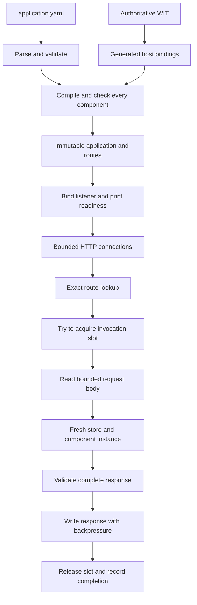

# Technology and internal architecture

Status: manifest loading, validation, and CLI metadata output are implemented.
The runtime and HTTP server remain planned. [SPEC.md](SPEC.md) defines host behavior;
[wit/world.wit](wit/world.wit) defines the guest interface and takes precedence
over any description of that interface. [application.yaml](application.yaml)
remains the complete configuration format.

Future runtime structures and ownership mechanisms below are provisional design
notes. Establish their boundaries when implementing the relevant behavior; do not
scaffold them in advance. The specification defines the required behavior and
limits, while implementation experience should guide the supporting structures.

## Decisions

| Area | Choice | Reason |
| --- | --- | --- |
| Host | Rust, one `wr` executable | Direct access to Wasmtime, explicit ownership of invocation resources, one deployable process |
| Runtime | Embedded Wasmtime with its Component Model API and Cranelift | Compile components once, generate typed bindings from WIT, instantiate independently per request |
| HTTP and scheduling | Tokio plus Hyper's HTTP/1 server API, `hyper-util`, `http-body-util`, and `bytes` | Control exact routing, connection admission, deadlines, and response ownership without a framework router |
| CLI | `clap` | A small typed `run` subcommand with a required manifest and optional numeric socket address |
| Manifest | `yaml_serde`, an embedded JSON Schema validated by `jsonschema`, and directly deserialized application types | Delegate YAML syntax and field validation to libraries while returning ordinary application values |
| CLI errors | `anyhow::Result` with context at operation boundaries | Preserve underlying causes through loading and command execution; print the error chain once at the CLI entry point |
| Diagnostics | `tracing` and `tracing-subscriber`; typed internal errors | Correlate host events per invocation and keep public HTTP errors separate from diagnostic detail |
| First guest examples | Rust with `wit-bindgen`, packaged using `wasm-tools` | Exercise the same WIT on both sides and provide a reproducible no-import guest build |

Use one Cargo package with internal modules initially, not a workspace of
services or pluggable runtime adapters. At implementation time select supported
stable releases, pin the Rust toolchain and guest tooling, and commit the host
and guest dependency lockfiles. This document does not prescribe unverified
version numbers or promise that moving `latest` documentation matches a future
lockfile.

Wasmtime is preferred because typed component execution and resource control
are core requirements. A browser engine or a core-module-only runtime would
require more component integration. Tokio/Hyper fits the small HTTP boundary;
a framework router adds little when route spelling must remain exact. There
is no database, broker, container orchestrator, or separate control plane.

## Component boundary

The host generates bindings directly from the checked-in `http-function` world.
Guests generate their own bindings from the same file. There is no handwritten
JSON protocol or second copy of the request/response schema.

The runtime creates an empty component linker. Do not register WASI, inherit
environment variables, preopen directories, or add a general capability registry.
A component must require no host imports and expose the expected typed handler.
Unrelated extra exports are unused. Standard WASI HTTP components are not
compatible automatically.

This intentionally trades ecosystem compatibility and guest streaming for a
small interface: one buffered request in, one buffered response out. Any future
host capability or different body model requires a deliberate contract revision.
The package version is an interface version, not an application version.

## Modules and ownership

The implemented module boundaries are:

| Module | Responsibility | Owns |
| --- | --- | --- |
| `cli` | Parse arguments and report startup failures | Manifest path and listener address |
| `manifest` | Parse, validate, resolve relative paths, and return application definitions | Embedded schema, application types, and loading errors |
| `run` | Orchestrate manifest loading and print metadata | Metadata output |

Runtime preparation, HTTP handling, shutdown, and diagnostics are future
responsibilities. Choose their module boundaries as those features are implemented.

Function definitions use a `HashMap` for lookup. The CLI sorts borrowed entries
when printing metadata; display order does not dictate application storage.

One possible prepared representation is an immutable application name, map from
function ID to prepared component, and route table. An exact map from raw path to
method entries could supply route lookup and a sorted `Allow` value. Decide the
concrete representation when implementing preparation and routing.

Shared engine and component handles may support reuse while each invocation owns
its guest state. A connection supervisor is one possible way to retain invocation
resources until transport completion; its necessity and shape should be established
alongside HTTP execution.

## Preparation transaction

1. Parse exactly one YAML document with `yaml_serde` into its generic value tree.
   Use the library's normal syntax and tag handling; aliases are supported and
   `apply_merge` resolves merge keys. Its mapping deserializer rejects duplicate
   keys. Convert the resolved tree into `serde_json::Value` and validate it using
   [application.schema.json](application.schema.json). The draft-07 schema owns
   field constraints, required and allowed properties, and the nonempty function
   map. Embed the schema and compile a local validator when loading the manifest.
   Disable `jsonschema`'s default features: this contract uses only local references
   and needs no HTTP or file retrieval. Report schema errors with JSON Pointer
   field paths; parser syntax errors retain their source locations.
2. Deserialize the validated values directly into `ApplicationDefinition`, including
   its HTTP method enum. The module-level `load` function resolves module paths
   against the manifest's directory and checks unique method/path pairs before
   returning. Callers receive ordinary application fields without YAML wrappers.
   Introduce private intermediate types only if parsing later requires a different
   representation; preserve the returned fields and semantics for callers.
3. Read each distinct resolved component file once and compile sequentially.
   Repeated references to that path share prepared code. Content-addressed or
   persistent caches are unnecessary initially. Never deserialize arbitrary
   precompiled native artifacts supplied as component files.
4. Resolve imports with the empty linker and verify expected exports through
   generated typed pre-instantiation bindings. Wasmtime's pre-instantiation
   resolves imports; typed binding preparation additionally checks exports.
   [Wasmtime linker documentation](https://docs.wasmtime.dev/api/wasmtime/component/struct.Linker.html)
   and [generated binding example](https://docs.wasmtime.dev/api/src/wasmtime/home/runner/work/wasmtime/wasmtime/target/debug/build/wasmtime-internal-component-macro/e864b396c211d56c/out/with-exports5.rs.html).
5. Assemble the immutable application, bind the socket, then print readiness.

Any failure drops the prepared application without starting a listener. Do not
execute handlers as a startup health check. Structural validation cannot prove
that initialization or a future handler call will succeed; runtime initialization
traps remain invocation errors. Files changed after preparation take effect only
after restart.

## Invocation lifecycle

1. Parse a request under the separate connection/header limits. Match its raw
   path and method before reading its body. Return 404 or 405 where appropriate.
2. Try to acquire one of four invocation permits. Failure returns 503 immediately;
   never await a permit. Start one absolute 30-second deadline on admission.
3. Read at most 1 MiB of body, validate and filter headers, and construct the WIT
   request. Preserve an absent query separately from a present empty query.
4. Create a new store with its limiter, instantiate the prepared component, and
   invoke the typed handler. Run instantiation, execution, and any generated
   post-return cleanup within the same deadline and cancellation scope.
5. Validate the complete WIT response before giving headers to Hyper. Enforce
   status, header, and body limits. Copy/own the response data on the host and
   drop the store after component cleanup; it need not live during socket writes.
6. Write the response under the remaining deadline. Keep the permit and host body
   buffer alive until the connection driver finishes that response or closes the
   connection. Record one completion event and release resources on every exit.

Returning a Hyper response from the service is not transport completion, and
yielding the last body frame does not prove that buffered socket writes finished.
Keep the invocation guard in connection-level response state. The implementation
must test how it observes the end of a response with the pinned Hyper version.
Do not silently release the slot when the guest returns.

Use a connection cancellation signal driven by connection errors, service/body
drop, shutdown, and the absolute deadline. On an observed disconnect, cancel the
invocation future and drop its store. Do not detach execution in an untracked
task. Keep-alive is allowed, but a connection's request lifecycle is sequential
for admission purposes; pipelined bytes must not create an application queue.
Verify disconnect handling against real TCP sockets, including during a looping
guest. Undetected network loss is bounded by the deadline.

## Scheduling and resource limits

Use Wasmtime's asynchronous embedding support with epoch-based cooperative
yielding, even though the guest WIT function is synchronous. These are separate
concepts: the host can yield while the guest computes without exposing an async
guest API. An ordinary async timeout alone cannot interrupt a CPU-bound guest.

A dedicated host ticker advances the shared engine epoch, initially every 10 ms.
Each store yields at epoch boundaries so Tokio can observe deadline expiration
or cancellation and drop the invocation future. The ticker must remain runnable
when every invocation is a loop. Stop and join it during shutdown. Epoch ticks
are scheduling opportunities, not precise elapsed-time accounting; use a monotonic
absolute deadline for the 30-second budget. This design must be proven with the
pinned Wasmtime release before relying on cancellation guarantees.
[Wasmtime's async epoch yielding](https://docs.rs/wasmtime/latest/wasmtime/struct.Store.html#method.epoch_deadline_async_yield_and_update)
documents the required external epoch driver.

Use a store-local resource limiter to enforce an aggregate 64 MiB linear-memory
budget, including initial allocations. Wasmtime's convenient per-memory size
limit alone is insufficient for components with multiple memories. Charge growth
deltas across memories and roll back reservations when allocation fails. With no
guest threads or host-created memory, accounting can be store-local. It is safe
to retain charges until the store is dropped rather than reclaim budget for
intermediate memories. Test failed growth and multiple-memory cases explicitly.
[ResourceLimiter](https://docs.wasmtime.dev/api/wasmtime/trait.ResourceLimiter.html)
provides allocation hooks but does not bound all host or runtime allocations.

Also cap each store at 64 core instances, 16 memories, 16 tables, and 10,000 total
table elements, and disable guest threads/shared memory and unused proposals.
These are fixed host-policy limits, not manifest fields. The first guest fixtures
must fit them. Preserve the runtime's stack bound. Over-limit instantiation or a
trap receives 500; a rejected memory growth may instead be handled by guest code.

Cap transport connections separately at 128, configure a 10-second header-read
and idle timeout, and enforce 100 fields/32 KiB of header data. Explicitly set
HTTP parser bounds rather than relying on defaults, which Hyper documents as
unstable. [Hyper HTTP/1 builder](https://docs.rs/hyper/latest/hyper/server/conn/http1/struct.Builder.html).
Close rejected requests with unread bodies. The four invocation slots bound both
body intake and slow response consumers, in addition to guest execution.

The WIT body and header limits are host policy, not type-level bounds. Generated
bindings may allocate while lifting a response before its length can be checked.
Guest memory limits therefore do not imply a strict process-memory ceiling;
compiled code, runtime metadata, stacks, buffers, and lifted values cost extra.
This is a local application server, not an adversarial multi-tenant service with
OS-enforced per-tenant quotas. Such a service would need a separate process-level
resource/isolation design.

## Shutdown and errors

On the first Ctrl-C or SIGTERM, stop accepting sockets and admitting requests,
disable keep-alive reuse, and allow already admitted invocations to finish for
up to 30 seconds. Their original deadlines remain in force. Then cancel remaining
work, close connections, join supervised tasks, and stop the epoch ticker.
A second signal skips the grace period.

Keep error categories explicit: configuration, preparation, bind, malformed
request, oversized request, overload, timeout, guest trap, invalid guest response,
client disconnect, and shutdown cancellation. The HTTP adapter maps these to the
spec's short public responses. The completion guard records function, method,
path without query, invocation ID, committed status if any, elapsed duration,
and terminal outcome once. A guest 500 is a successful guest response, distinct
from a host-generated 500. There is no guest stdout/stderr capability.

## Implementation sequence and proof points

1. Establish the guest toolchain: generate bindings, build greeting and binary
   echo components, inspect their imports, and invoke them through an empty
   linker. Start with Rust `wasm32-unknown-unknown` and explicit component
   packaging; verify the result rather than assuming a target has no imports.
   Use `wit-bindgen` for the guest and `wasm-tools` to package/inspect it. The
   precise build recipe belongs with runnable examples once tested.
   [wit-bindgen documentation](https://github.com/bytecodealliance/wit-bindgen).
2. Prove fresh instances, aggregate memory accounting, and interruptible looping
   guests in a small runtime harness, including loops during initialization.
3. Implement strict manifest preparation and CLI readiness/error behavior.
4. Add exact HTTP routing, translation, admission, and connection supervision.
   Test real-socket disconnects, slow consumers, oversized outputs, and cleanup.
5. Complete the acceptance cases in [SPEC.md](SPEC.md), especially restart on
   the same port, four occupied slots rejecting a fifth request, and cancellation
   releasing slots. Use unit tests for manifest/routing and integration tests with
   tiny purpose-built components for execution and transport behavior.

Keep the no-import guest build, epoch cancellation, and transport-completion
ownership as the first implementation proofs. If a chosen dependency version
cannot support them, revisit that implementation choice explicitly without
weakening the WIT contract or silently adding WASI imports.
