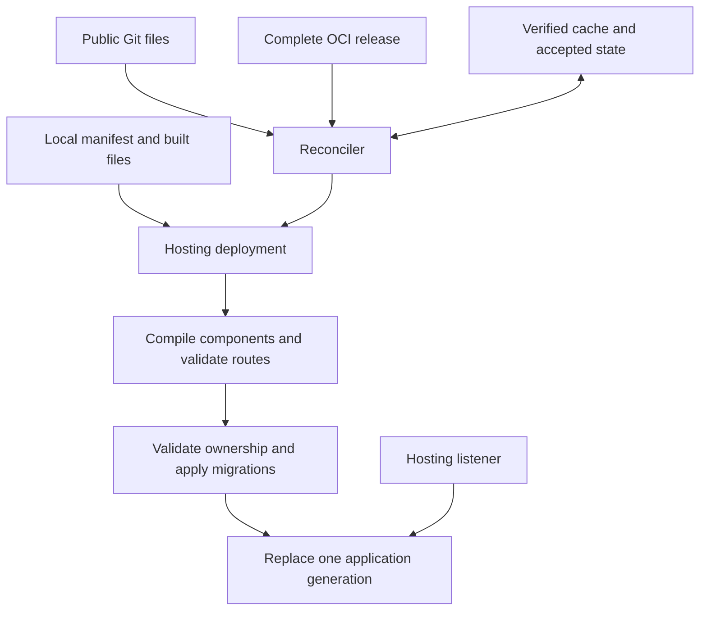
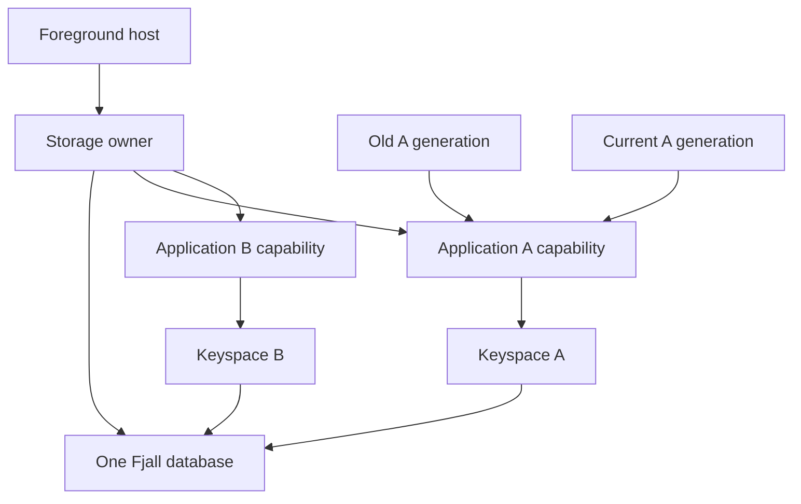

# Architecture

This page explains the current runner's responsibilities and design choices.
[Requirements](SPEC.md) state the outcomes; the [reference](docs/reference.md)
defines exact public behavior. Contributor commands and verification practices
live in [Contributing](CONTRIBUTING.md).

## Structure

The runner is one Rust package with a library and a thin CLI binary. Modules
are grouped by responsibility; the runtime and foreground server remain publicly
re-exported for embedding. Application handlers compile in separate generated
guest workspaces.

| Component | Responsibility |
| --- | --- |
| [main](src/main.rs) | Report errors and return the process exit status |
| [CLI](src/cli/mod.rs) | Parse arguments and dispatch commands |
| [Application commands](src/cli/application), [start command](src/cli/start.rs) | CLI orchestration and signal handling |
| [Identifiers](src/identifier.rs) | Shared application/function names and storage identities |
| [Project](src/project) | Local manifest validation, source discovery, generation, builds, and local packaging inputs |
| [Host](src/hosting/host.rs), [state directory](src/hosting/state.rs) | Compose listeners, hold the process lock, drain work, and sync storage |
| [Reconciler](src/deployment/reconcile.rs) | Membership, authorized versions, retry decisions, and recovery |
| [Repository adapter](src/deployment/repository.rs), [registry adapter](src/deployment/registry.rs) | Read public Git files and OCI artifacts through small application-facing interfaces |
| [Release](src/deployment/release.rs), [package](src/deployment/package.rs), [cache](src/deployment/cache.rs) | Release validation, OCI layout export, and durable cached bytes/state |
| [Admin UI](src/admin) | Direct read-only host inspection, health responses, and HTML presentation |
| [Applications](src/hosting/applications.rs) | Prepare, publish, list, and remove application generations |
| [Routing](src/hosting/routing.rs) | Construct and validate each application’s prepared Rocket routes |
| [Hosting server](src/hosting/server.rs) | Translate HTTP, bound execution admission, and drain shutdown |
| [Handler metrics](src/hosting/metrics.rs) | Aggregate bounded per-generation handler windows and produce snapshots |
| [Runtime](src/runtime/mod.rs) | Compile components, own the engine/ticker, and invoke fresh isolated instances |
| [KV persistence](src/persistence/storage.rs) | Own the shared database, bind application keyspaces, validate typed operations, sync, and inspect |
| [SQL persistence](src/persistence/sql) | Own application databases, restrict SQL execution, apply migration history, and inspect |
| [Migration packaging](src/project/migrations.rs) | Discover named SQL files and produce validated deployment records |

Project tooling knows files and Cargo. Both local packaging and release loading
produce the [hosting deployment value](src/hosting/deployment.rs): identity,
prefix, capability configuration, migration records, and component bytes. The
runtime remains independent of manifests, source locations, Git, and OCI.

The [deployment interfaces](src/deployment/ports.rs) expose repository-file
observations, release/artifact reads, and application installation/removal. They
are narrow boundaries for reconciliation logic, not general transport providers.
The production implementations use Git, the OCI client, and the existing
application registry. Tests substitute simple observations and outcomes at these
interfaces; there is no fake Git server or registry protocol implementation.

### Module grouping

The runtime uses a directory module, following the existing CLI, hosting, and
project layout. Persistence lives alongside it:

```text
src/
  lib.rs
  main.rs
  persistence/
    mod.rs
    storage.rs
    paths.rs
    sql/
      mod.rs
      connection.rs
      access.rs
      cursor.rs
      migrations.rs
      history.sql
  runtime/
    mod.rs
    sql.rs
```

[persistence/mod.rs](src/persistence/mod.rs) exposes the concrete `Storage` owner,
`KvStore` capability, typed values/errors, and inspection records. Engine details
remain private in [storage.rs](src/persistence/storage.rs). The concrete
[SQL module](src/persistence/sql/mod.rs) owns separate SQLite
databases; both engines share private path validation. There is no provider
trait or additional crate.

The runtime implementation lives in [runtime/mod.rs](src/runtime/mod.rs).
The existing `pub mod runtime` declaration and public paths such as
`wasm_runner::runtime::Runtime` remain unchanged. SQL guest conversion lives in
a private child module; other runtime responsibilities remain together.
The runtime remains independent of HTTP hosting and uses the concrete KV/SQL
capabilities supplied to it; it does not own storage-path selection.

## Important flows



Run and package read existing components without invoking Cargo. Package writes
OCI layouts for an external CI publisher. The release record is published last;
its child digests bind the complete artifact set. Production reads only manifests
from Git, never checks out application code or invokes application builds. The
reconciler rechecks authorization after downloads and before installation.

YAML parsing and merge resolution use `yaml_serde`. The resolved document is
validated by `jsonschema` against the embedded schema and deserialized into
application types. Rocket parses route URIs and rejects route collisions during
dispatcher ignition. Source existence needs filesystem checks. Diagnostics use
basic operation context through `anyhow`; there is no custom source-location
tracking. See [validation stages](docs/reference.md#validation-stages).

## Live applications and host lifecycle

The application registry holds a sorted map of names to immutable application
generations. Each generation owns its declared path prefix, one runtime, and an
untracked asynchronous Rocket local client. Component preparation runs on the
blocking pool, and that application's routes are validated before publication.
A short read/write lock protects checking prefix ownership against the latest
registry and replacing the application. Duplicate and ancestor/descendant
prefixes are rejected. Shutdown checks use the same lock, so a late deployment
cannot publish after admission closes. Old generations are dropped outside the
lock. Independent application routers remove the need to rebuild a combined
router or serialize asynchronous preparation across applications. A separate publication
mutex serializes migration/publication and removal after preparation; it never
blocks HTTP registry reads. Prefix ownership is checked while holding that
mutex before migration work starts, and shutdown is checked again at publication.

The network listener selects an application using its literal, segment-bounded
prefix, removes that prefix, and forwards the remaining encoded path and original
query into the application's in-process Rocket dispatcher. `/` is the remaining
path for a request exactly at the mount point. Prefixes are canonical unreserved
ASCII paths; there are no dynamic prefix captures or encoded aliases. Function
routing, decoding, ranking, and collision detection remain Rocket's responsibility.
The manifest owns the prefix for both run and deployment. Neither command
infers it from the name, accepts an override flag, or retains an old prefix.

Rocket's route matcher is private and its live route set is immutable; local
dispatch preserves its behavior without implementing a second function router.
It opens no additional listening sockets. The tradeoff is an additional bounded
request-buffer copy and response adaptation. Clients are untracked so cookies
are not shared between requests. HEAD forwarding preserves the representation
size even though local dispatch has already stripped its body.

The listener and every application share one execution-admission state. Requests
retain the selected application through dispatch; blocking executions also own
its runtime. Replaced/removed generations are reclaimed after the final
reference drops. Per-generation runtimes avoid changing the public runtime API,
at the cost of an engine and ticker per deployed application generation. The
public `server::serve` embedding API remains rooted at `/`; the foreground CLI
uses the same registry and hosting path with the manifest's prefix.
The shared foreground host owns the state-directory lock, storage owners,
application listener, optional admin listener, and reconciliation task. Signals
close admission, stop further reconciliation, drain work, and sync KV before
the lock is released. Lock ownership is kernel-backed; PID files and stale-lock
removal are unnecessary. An external process manager owns restart policy.

## Local admin UI

The host's optional loopback Rocket listener reads the application registry and
reconciliation status directly. It has no mutation API or separate process.
Application metadata comes from active dispatchers and generation-owned metrics;
storage inspection runs outside registry locks. HTML rendering stays in the
private renderer and assets are embedded.

Route preparation also creates a shared metrics window per handler name. The
registered handler records completed dispatch latency and the translated HTTP
status through the metrics API. That API owns the per-handler mutex and samples
the clock while holding it, keeping timestamps ordered without exposing that
requirement to callers. The application generation owns the same metrics and
snapshots them when listing its functions. One-second aggregate
buckets bound memory independently of request volume; expiry on both recording
and inspection avoids a timer task and keeps idle views current. Generation
ownership naturally isolates replacement metrics from still-running old calls.
The runtime has no knowledge of HTTP metrics or admin presentation.

Storage inspection has a five-second deadline. HTML refreshes every five seconds
with an explicit request URI, including errors, so fragment navigation cannot
substitute for a new metadata request. Status reports accepted configuration,
desired and active versions, observed commits, and failures separately from the
liveness and readiness endpoints.

Rocket's HTML responder wraps a small embedded page shell and directly rendered,
escaped status and table content. The private [renderer](src/admin/render.rs)
owns the page shell, markup, escaping, and metric formatting; the
[admin server](src/admin/mod.rs) owns metadata requests, HTTP status codes,
response headers, and listener lifecycle. Application table rendering is split
into collection and row functions to keep retained-storage handling separate
from page orchestration. The stylesheet is also embedded. The overview
and linked handler detail pages need no template-engine dependency, frontend build, runtime asset files,
or separate browser API. Exact behavior lives in the
[admin reference](docs/reference.md#admin-ui).

## Guest workspace boundary

Guest and runner workspaces are separate so application dependencies, lockfiles,
and build artifacts have their own lifecycle. The application-root Cargo
manifest also gives editor tooling a discoverable workspace. Each discovered
function gets a `cdylib` package with explicit workspace membership and a
library name, making artifact paths predictable. The
[generated-file reference](docs/reference.md#generated-files) defines the layout.

Generated entry points include the original handler sources and use the embedded
[WIT world](wit/world.wit) to generate bindings. They implement the exported guest
trait and expose its `Request` and `Response` types directly to handlers.
There is no parallel request/response model or conversion layer to keep in sync.

When the application has `libs/mod.rs`, each entry point also includes it as
`crate::libs`. Ordinary Rust module declarations own the shared source tree.
Including source in the handler crate lets shared helpers use that crate's WIT
bindings directly, without a separate guest API crate or cross-crate type
conversion. The tradeoff is compilation in each handler's dependency context;
this shares source, not runtime state or separately deployed components.

The example's shared view module derives Askama templates at compile time and
returns the ordinary HTTP response type. Workspace generation writes a small
inline Askama configuration beside each handler's Cargo manifest, pointing to
the application's template directory.
This keeps knowledge of generated paths in the generator and lets views use
Askama's default configuration lookup. The file is harmless when Askama is not
a dependency, so no engine flag or conditional directory discovery is needed.
Templates are read at build time without copying them into generated output;
they and inherited layouts become part of the component. The runtime needs no
rendering import or filesystem access.

The original sources live outside the generated package directories. Setup
therefore merges rust-analyzer source includes into the application's editor
settings; Cargo resolves the source paths without that configuration. The
[editor guide](docs/guides.md#prepare-vs-code) covers workspace selection.

## Generation and ownership

Generation produces a sorted map of relative paths to contents before any
writes. Preview and writing share that output, so validation and rendering
failures cannot leave a partially generated workspace. TOML serialization uses
`toml`; `jsonc-parser` merges editor settings while preserving existing comments
and formatting. Ignore entries are merged as literal lines rather than by
interpreting pattern semantics.

The writer checks the root manifest's ownership marker before modifying files
and skips identical content to preserve incremental compilation. Cleanup checks
the same marker before removing its documented outputs. These checks protect
handwritten manifests; they do not make filesystem operations transactional.
Obsolete generated files stay in place until cleanup. Exact preservation and
failure boundaries are in [Setup](docs/reference.md#setup) and
[Clean](docs/reference.md#clean).

## Compilation and publication

Cargo owns dependency resolution, lockfiles, incremental compilation, concurrency,
and compiler diagnostics. The build service supplies the WASM target, profile,
and application-local target directory. It computes artifact paths from explicit
library names instead of parsing Cargo JSON output, reducing orchestration to
the information it needs.

Builds pass `--locked` to Cargo unless the user explicitly selects `--unlocked`.
Update shares workspace generation and ownership checks, then delegates to
`cargo update` without compilation or publication. This keeps dependency upgrades
explicit and uses Cargo's resolver instead of maintaining separate lockfile logic.

Only successful compilation followed by existence checks for all expected
artifacts allows publication to begin. This prevents failed Cargo builds from
publishing stale outputs as new successes. Copies are not transactional: a later
copy failure can leave mixed published outputs. See [Build](docs/reference.md#build).

## Runtime and transport boundaries

The runtime owns a Wasmtime engine with epoch interruption and a dedicated
ticker thread. It retains typed pre-instantiated component metadata after
registration resolves imports and checks exports. Every call creates a new
store, resource table, WASI context, and guest instance. Registration takes
mutable access; execution shares immutable prepared code without a shared
guest instance or execution mutex. Opaque IDs carry runtime ownership identity.
Dropping the runtime signals and joins its ticker thread.

Deadlines are configured to trap, not yield. The allowance starts inside the
synchronous invocation and includes instantiation. An extra epoch tick prevents
calls arriving just before a tick from expiring early; the elapsed-time check
also catches calls that return after their allowance. Epochs cannot interrupt
arbitrary host functions. A registration allowlist and capability-free WASI
contexts limit the current host surface to the
[documented policy](docs/reference.md#runtime-and-wasi-policy).

Each application dispatcher registers each configured URI directly as a Rocket route
with its default rank. Rocket owns routing, method matching, collision detection, and
slash handling. There is no parallel route ordering or overlap algorithm.
A private request adapter owns headers, query grouping, and pairing capture names
from the matched route with Rocket's decoded request segments for the WIT request.
Dispatch separately owns admission, blocking execution, and response/error mapping. The encoded application-relative path comes from
Rocket's local request URI after prefix removal. The hosting listener's liftoff callback reports the actual bound address
only after ignition and binding succeed.

Each request buffers a bounded body under a read timeout before attempting an
immediate execution-slot acquisition. Synchronous runtime calls run through
Tokio's blocking pool. The owned semaphore permit moves into the blocking job,
so dropping an HTTP future cannot release capacity prematurely. Shutdown marks
admission closed, notifies Rocket, and acquires all permits before
returning, including permits held by detached jobs. Process signals are the
CLI's responsibility; embedding callers provide a shutdown future.

The runtime exposes request/response types generated from the same WIT
used by guest workspaces. Its API does not depend on manifest or CLI types. The server
encapsulates module IDs and confines HTTP validation, framing, and error mapping
to the transport boundary. No separate runtime test harness is maintained:
examples exercise it through the server, with straightforward automated socket
checks and manual concurrency/failure scenarios.

## KV storage

One embedded Fjall database belongs to each selected host root. Application
keyspaces isolate values while sharing the journal, caches, maintenance workers,
filesystem, and storage health. There is no runner-owned mirror map, mutation
queue, snapshot writer, or periodic batch scheduler. Exact identity, limits,
durability, and preservation rules live in the
[reference](docs/reference.md#persistent-application-kv).

### Owners and capabilities

`Storage` owns a lazily initialized engine, retained application handles, and
sync statistics. Construction performs no I/O. An initialization mutex serializes
opening and handle creation, separate from the short metadata-map lock. The
engine is published through `OnceLock`; inspection never takes the initialization
mutex or opens the database. Once opened, existing keyspaces are discovered so
inactive application data remains visible after restart.

`KvStore` holds one transactional keyspace, its operation statistics, and an
engine lifetime reference. A runtime receives this capability, never the storage
owner or a guest-selected keyspace name. Handles retain the engine but not the
owner, avoiding a cycle. Fjall retains its exclusive filesystem ownership
lock until all capabilities and the database have dropped. Hosts select roots;
storage validates managed paths and private directory permissions. Before opening
a nonempty directory it requires Fjall's version marker, preventing the engine
from initializing over unrecognized or damaged storage.



Fjall's `SingleWriterTxDatabase` makes boolean-returning deletion atomic through
`take`. Increment uses one explicit write transaction: read, strictly decode,
check type, checked-add one, encode, insert, and commit. It returns the computed
value without rereading after commit. Validation failure drops the transaction.
Set and delete use the same transactional keyspace API. Write transactions
serialize across the shared database, a deliberate simplicity/throughput tradeoff.

### Typed encoding

The private codec stores a tag byte followed by payload: `0` for bytes, `1` for
UTF-8 text, and `2` for an eight-byte little-endian signed integer. Set replaces
the whole encoding. Limits exclude the tag. Unknown/missing tags, invalid UTF-8,
and malformed integer lengths are storage failures; valid noninteger values
produce type mismatch on increment. Storage does not depend on generated WIT
or runtime types; the runtime translates values and errors at the boundary.

### Preparation and execution

Manifest and release parsing accept only the boolean capability
flag, defaulting omission to disabled. During blocking preparation, the
application registry obtains the handle before compiling/linking components and
preparing routes. It then rechecks shutdown and prefix ownership under the
publication lock. No database I/O runs while that lock is held. Failed
preparation can leave initialized empty storage, but cannot clear data or replace
published routes. Old generations retain their capability.

The separately versioned `local:kv/store@0.1.0` import is linked independently
of the WASI allowlist. The HTTP export stays at `local:http/handler@0.2.0`.
Generation embeds both WIT files with named `include_str!` constants and exports
bindings as `crate::kv`. Each fresh invocation gets the runtime's optional
capability and checks it on every operation. Disabled runtimes still link the
interface, returning a typed disabled error.

Calls execute in the existing bounded blocking path. Checks before and after
host calls enforce the elapsed deadline, but guest epochs cannot interrupt
native database I/O. Permits remain held until execution returns. An accepted
mutation remains accepted when the post-call deadline check traps.

### Sync and inspection

Default Fjall journal persistence flushes to OS buffers. Per-call durable sync
is not requested; normal engine maintenance and backpressure remain enabled.
Host shutdown drains both reconciliation/preparation work and guest execution before
explicit `persist(SyncAll)`, reporting the outcome before releasing handles and
the host state-directory lock. Foreground and the storage-enabled embedding server
use the same explicit boundary. Direct storage/runtime embedders own draining
and sync themselves.

Thin per-operation statistics retain counts, failures, totals, and maxima.
Inspection clones handles under the metadata lock, then queries inexpensive
engine statistics outside it. Keyspace disk usage is read through the transactional
handle's `inner()` accessor; all mutations still use transactional operations.
Estimated entries, whole-database disk bytes, and journal counts are also available.
No entry scan or mirror map is maintained to invent missing measurements.
Admin requests use blocking jobs for inspection, independently of shutdown
signals, so a slow sample does not delay closing admission. Sync results and shared storage failures are
logged without keys or values.

Public storage tests exercise real temporary databases. Independently named CLI
tests cover building, HTTP dispatch, local hosting/admin, runtime KV, and
foreground hosting. Hosting tests compile their current components once per test
process and share only immutable bytes; each workflow owns its mutable fixtures.
Build verification and frozen HTTP-only compatibility use separate workspaces so
mutations and assertions in those workflows cannot affect the shared components.
See [requirements](SPEC.md#persistent-application-kv) and the
[manual storage workflow](docs/guides.md#observe-kv-storage). No latency isolation
or hard disk-stall bound is claimed.


## SQL storage and deployment migrations

Bundled SQLite supplies a separate database per application identity. Fjall
remains the KV engine; there is no transaction spanning KV and SQL. `SqlStorage`
selects and validates managed paths and lazily opens application handles.
`SqlStore` retains one writer, a lazy read pool, its exclusive ownership file lock, current
migration ID, and bounded operation statistics. As with KV, retained handles
outlive removed generations and are discovered on the first SQL-enabled opening.
An initialization mutex is separate from the handle-map lock; inspection clones
handles before filesystem work and never waits for a query connection.

The [connection module](src/persistence/sql/connection.rs) owns engine settings,
authorization, input validation, and write-transaction cleanup. WAL permits read
snapshots to coexist with the single queued writer. The
[connection access module](src/persistence/sql/access.rs) leases the writer or a
reader, opens readers lazily up to the fixed capacity, and uses a condition
variable for deadline-aware acquisition. No pool mutex is held over SQLite I/O.
Returned connections have their invocation hooks cleared; unhealthy connections
are discarded. Waiting retains the existing bounded execution permits.

The [cursor module](src/persistence/sql/cursor.rs) owns each read statement and
its leased connection. Query prefetches at most one row to establish the snapshot;
subsequent calls copy one row at a time. Column and per-row limits replace the
previous accumulated-result limits. The cursor owns an application capability
reference, keeping the database lock alive. Exhaustion, close, errors, and drop
finalize the statement before returning the connection. A pool lease may move
between execution threads but is never shared concurrently.

Rusqlite's borrowed row iterator cannot be retained across independent guest
calls. The cursor module therefore confines SQLite C statement preparation,
binding, stepping, and finalization behind an owned wrapper. Its explicit Send
implementation is justified by exclusive ownership of both statement and
connection, which always move together; it is not Sync. Bound buffers are copied
by SQLite and result buffers are copied before advancing the statement. Write
execution and migration SQL continue to use rusqlite's ordinary APIs.

The runtime binds `local:sql/database@0.2.0` independently of the HTTP export and
KV import. A concrete `Capabilities` struct carries optional KV and SQL handles;
existing constructors preserve their behavior. SQL WIT conversion belongs to a
private runtime child module. Cursor resources live in the invocation's resource
table and are destroyed even when guest code leaks a handle, traps, or times out.
The resource limit bounds metadata as well as active readers. A nested query
cannot wait for a full pool while retaining other cursor handles, avoiding
cyclic waits between handlers. Exact limits live in the
[SQL reference](docs/reference.md#sql-guest-operations-and-limits).

Guests cannot choose database identities or paths. Parameterized execute and
atomic mutation batches use the writer; queries always use read-only pool
connections with the same authorization policy. Schema changes belong to
migrations. SQL 0.1.0 components need rebuilding for the cursor interface;
HTTP-only and KV compatibility is preserved.

The [migration module](src/persistence/sql/migrations.rs) validates history and
constructs the ordered apply/rollback plan. An embedded schema creates the
runner-owned history table. SHA-256 hashes cover the exact UTF-8 bytes of each
file, including optional rollback content. Rolled-back records remain immutable.
The entire transition and history updates use one database transaction.
Authorization is active only around application SQL; trusted history operations
and transaction boundaries run outside that restricted scope. The SQLite binding
requires mutable connection access to install/remove hooks, so the private
transaction guard owns that access and rolls back on every uncommitted exit.
Both forward and rollback SQL are restricted from history, external databases,
engine configuration, and transaction control.

Project packaging reads the fixed migration directory into bounded records.
Local loading and OCI release loading produce the same migration records
alongside component bytes, without production access to source paths. Component compilation and
Rocket route preparation happen first. Once the publication mutex is held, the
registry validates prefix ownership, runs migrations on the blocking pool, and
publishes the generation. The blocking migration job retains the mutex even if
its awaiting future is cancelled. Registry read/write locks are never held over
SQL I/O; other HTTP applications remain available. This serializes final application
mutations across applications as a deliberate first-version simplicity tradeoff.

A database commit and registry publication are not one atomic transaction.
Failure between them can preserve the new schema with the old code. Existing
generations also finish requests against the changed schema. Authors therefore
own compatibility across every generation that may still run. Migration targets
allow schema-first, code-first, or combined deployment without moving migration
machinery into guest handlers. Exact behavior and limits belong to the
[SQL reference](docs/reference.md#persistent-application-sql).

Connections use FULL synchronous writer commits and WAL, so SQL needs no
separate KV-style shutdown sync operation. SQLite owns automatic checkpointing;
active read snapshots can retain WAL pages until their cursors close. Hosts drain preparation and
executions before releasing handles. SQLite progress callbacks enforce elapsed
query allowances; neither progress callbacks nor guest epochs can forcibly
interrupt stalled native I/O. Status/admin report database migration state
independently of the published generation, with retained owners and operation
failures visible after removal.
